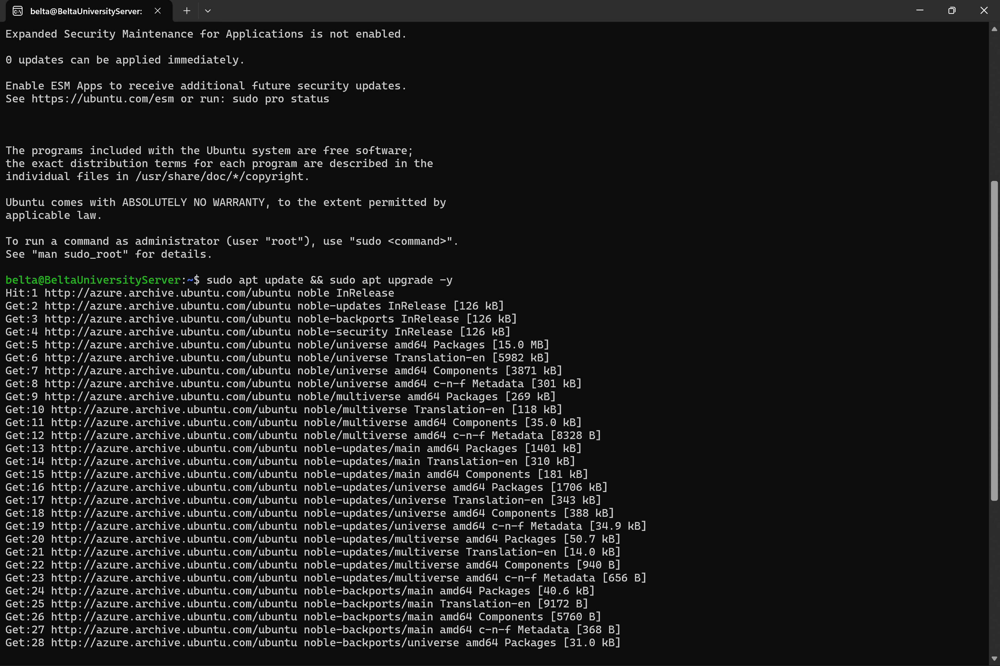
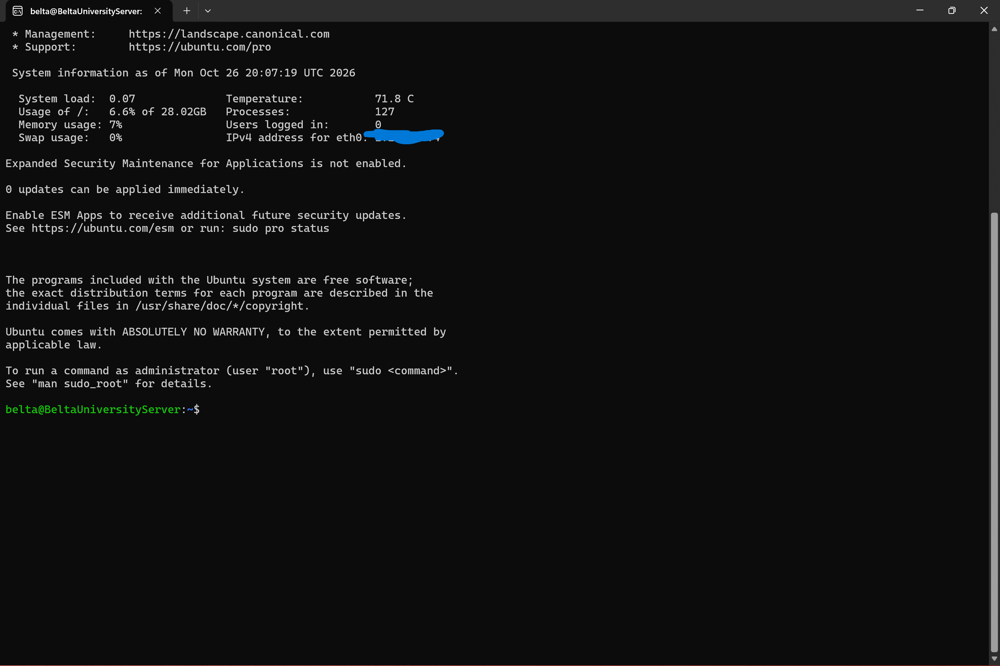
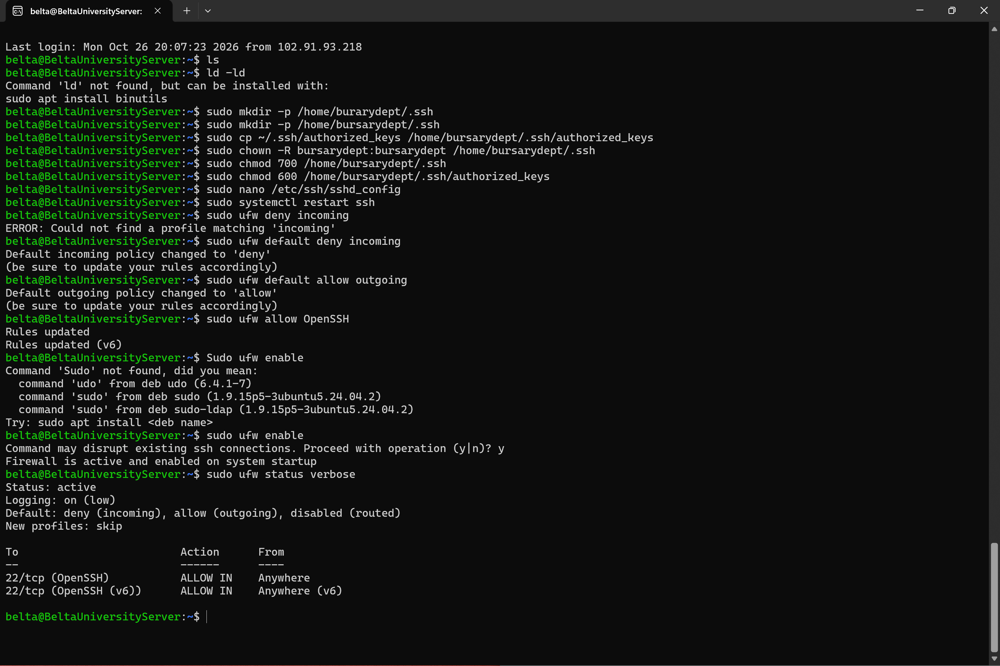
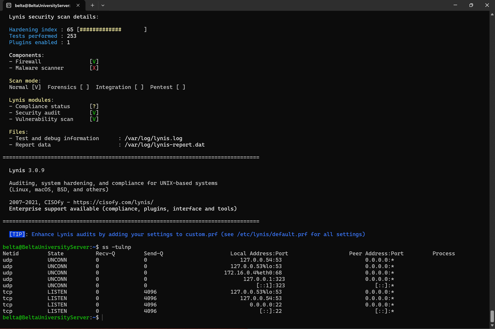

# Azure-Linux-Server-Hardening-Lab
  

Hardening a university  public-facing Ubuntu server in Microsoft Azure using SSH key authentication, create a dedicated admin user, enable SSH configuration lockdown, host firewall, run automatic patching and a Lynis security audit.

  

---

## Objective

Take a freshly deployed cloud VM, which is exposed to the internet and constantly scanned, and reduce its attack surface using standard hardening practices. 

## Environment

| Component | Detail |
|---|---|
| Cloud provider | Microsoft Azure |
| Image | Ubuntu Server LTS |
| VM size | Standard B-series  |
| Authentication | SSH public key (password login disabled) |
| Admin workstation | Windows 11 with WSL2 (Ubuntu) |
| Inbound access | TCP 22 (SSH) only |

> Public IPs, usernames and key names are intentionally replaced with placeholders in this documemtation.

## Architecture

```
 [ Windows PC + WSL2 ]
          |
          |  SSH (port 22, key auth)
          v
 [ Azure NSG firewall ]  <- Layer 1: allows TCP 22 only
          |
          v
 [ Ubuntu VM + UFW ]     <- Layer 2: host firewall, deny incoming by default
          |
   sshd (hardened)  |  unattended-upgrades  |  Lynis audit
```

Two firewall layers (NSG and UFW) provide **defense in depth**. If one is misconfigured, the other still protects the server.

---

## Step 1: Create the VM securely

- Created a new resource group and an Ubuntu Server LTS VM
- Authentication type: **SSH public key** (password authentication not offered)
- Inbound port: **SSH (22)** only
- Downloaded the `.pem` private key 
**Issue encountered:** `NotAvailableForSubscription` when selecting a VM size.
**Cause:** Azure restricts some VM sizes per subscription and region.
**Fix:** Chose a different size and region that had no restrictions on the subscription.

## Step 2: Connect over SSH from WSL

```bash
mkdir -p ~/.ssh
cp "/mnt/c/Users/***/Downloads/******.pem" ~/.ssh/
chmod 600 ~/.ssh/****.pem
ssh -i ~/.ssh/****.pem belta@20.11*.***.**
```

## Step 3: Update the system

```bash
sudo apt update && sudo apt upgrade -y
```

Cloud images can contain known vulnerabilities until patched, so this is done immediately after first login to patch the server


## Step 4: Create a separate admin user (least privilege)

```bash
sudo adduser bursarydept
sudo usermod -aG sudo bursarydept

sudo mkdir -p /home/bursarydept/.ssh
sudo cp ~/.ssh/authorized_keys /home/bursarydept/.ssh/
sudo chown -R bursarydept:bursarydept /home/bursarydept/.ssh
sudo chmod 700 /home/bursarydept/.ssh
sudo chmod 600 /home/bursarydept/.ssh/authorized_keys
```

Tested the new account from a **second terminal** while keeping the original session open, so a mistake could not lock me out.


## Step 5: Harden SSH

Edited `/etc/ssh/sshd_config`:

| Setting | Value | Purpose |
|---|---|---|
| `PermitRootLogin` | `no` | Block direct root login attempts |
| `PasswordAuthentication` | `no` | Force key-only authentication |
| `PubkeyAuthentication` | `yes` | Allow key-based login |

```bash
sudo systemctl restart ssh
```

## Step 6: Configure the host firewall (UFW)

```bash
sudo ufw default deny incoming
sudo ufw default allow outgoing
sudo ufw allow OpenSSH      
sudo ufw enable
sudo ufw status verbose
```


## Step 7: Automatic security updates

```bash
sudo apt install unattended-upgrades -y
sudo dpkg-reconfigure --priority=low unattended-upgrades
```

## Step 8: Audit with Lynis and review listening ports

```bash
sudo apt install lynis -y
sudo lynis audit system
ss -tulnp
```

| Metric | Result |
|---|---|
| Lynis hardening index | `65` / 100 |
| Unexpected listening services | None |


---


## Security principles demonstrated

| Control | Principle |
|---|---|
| SSH keys, no passwords | Strong authentication |
| Separate sudo user, root login disabled | Least privilege, separation of duties |
| Azure NSG + UFW | Defense in depth |
| unattended-upgrades | Patch management |
| Lynis, `ss -tulnp`, log review | Continuous security assessment |


## Future improvements to improve the lynis audit score

- [ ] Restrict the NSG SSH rule to my own IP address instead of "Any"
- [ ] Install and configure `fail2ban`
- [ ] Re-run Lynis and compare scores before and after further hardening

## Screenshots

